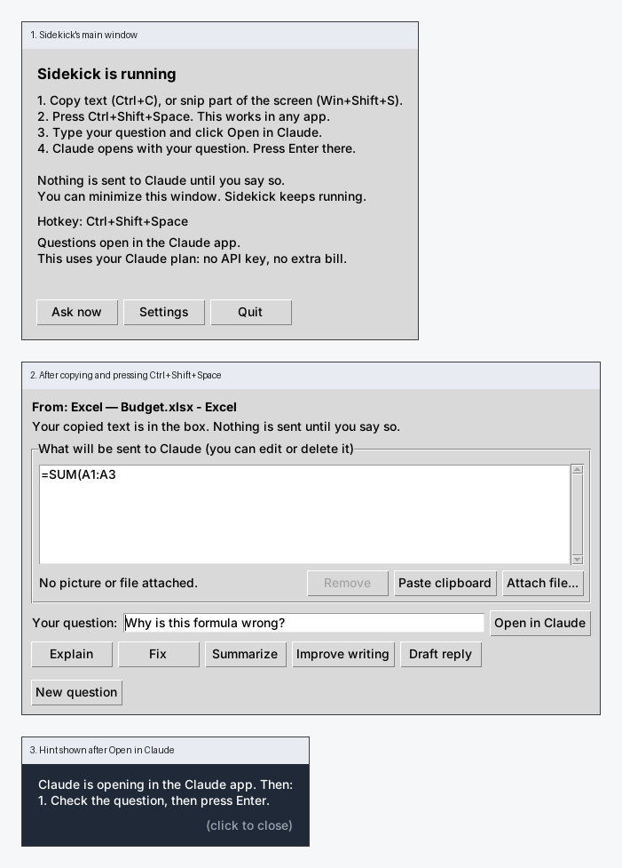

# Sidekick: ask Claude from any Windows app

Sidekick is a small helper for Windows. Copy something in **any** app,
press **Ctrl+Shift+Space**, type a question, and Claude opens with your
question already filled in. You check it and press Enter.

It uses your normal Claude plan (Free, Pro, Max, ...). **No API key and
no extra bill** are needed.

It works the same in Excel, Word, Outlook, your browser, PDFs, error
messages, chat apps: anything you can copy text from or take a snip of.



*Pictures from a test run. On Windows the buttons and borders look like
normal Windows ones.*

## How it works

```text
 1. Copy something
    (Ctrl+C), or snip
    the screen
    (Win+Shift+S)
          |
          v
 2. Press
    Ctrl+Shift+Space
          |
          v
 3. Sidekick shows what
    it picked up. Type
    a question or click
    a button.
          |
          v
 4. Click "Open in
    Claude". Claude
    opens with your
    question filled in.
          |
          v
 5. Check it and press
    Enter in Claude.
    Only now is it sent.
```

## What you need

- Windows 10 or 11.
- Python 3.12 or 3.13 (free, from python.org).
- A Claude account (any plan, including Free).
- The Claude desktop app (free, from claude.com/download), signed in.
  If you prefer, Sidekick can use the Claude website in Chrome instead.

## Install (about 10 minutes, only once)

**1. Install Python**

1. Open https://www.python.org/downloads/windows/ and download the
   "Windows installer (64-bit)" for Python 3.12 or 3.13.
2. Run it. Tick **"Add python.exe to PATH"**, then click **Install Now**.

**2. Install the Claude app**

Download it from https://claude.com/download, install it and sign in.
(Using Chrome instead? Make sure you are signed in at claude.ai, then pick
Chrome in Sidekick's Settings later.)

**3. Get the Sidekick folder**

1. On GitHub, open this repository and switch to the branch that has
   Sidekick in it.
2. Click **Code**, then **Download ZIP**, and unzip it.
3. Open the `claude-sidekick` folder inside.

**4. Set it up**

Double-click **`1-Setup.bat`** and wait until it says **Done!**

If Windows says "Windows protected your PC", click **More info**, then
**Run anyway**. Only do this for files you trust.

**5. Start Sidekick**

Double-click **`2-Start-Sidekick.bat`**. The Sidekick window opens. That's it.

**6. Optional: start it automatically**

Double-click **`3-Start-With-Windows.bat`** and Sidekick will start by
itself every time you sign in to Windows.

## Everyday use

- **Ask about text:** select it, press Ctrl+C, press Ctrl+Shift+Space,
  type your question and press Enter. Claude opens with everything filled
  in. Press Enter again in Claude.
- **One-click help:** instead of typing, click **Explain**, **Fix**,
  **Summarize**, **Improve writing** or **Draft reply**.
- **Ask about something on screen:** press Win+Shift+S, drag over the
  area, then press Ctrl+Shift+Space. In Claude, press **Ctrl+V** to add
  the picture.
- **Ask about a file:** in the Sidekick window click **Attach file...**.
  Sidekick shows the file in File Explorer: drag it into the Claude window.
- **Follow-up questions:** ask them in Claude, as usual.
- A dark hint at the top of the screen always says what to press in Claude.
  Click it to close it.

## Three ways to get answers

Choose in **Settings > Send questions to**:

- **The Claude app on this PC** (the default): uses your Claude plan,
  no extra cost.
- **The Claude website in Chrome**: also uses your Claude plan. Sidekick
  copies your question and opens claude.ai; press **Ctrl+V**, then Enter.
  (Copying instead of putting the question in the web address keeps it out
  of Chrome's history.)
- **Answer inside Sidekick**: Sidekick asks Claude itself and shows the
  answer in its own window. This needs an Anthropic API key and is billed
  separately, pay as you go (about 1 to 2 US cents per question). Claude
  Max, Ultra and Team plans include monthly API credits that can pay for
  this. To set it up, create a key at
  https://platform.claude.com/settings/keys, then paste it in Settings.

Sidekick never uses your Claude login itself. Anthropic does not allow
other apps to do that, so Sidekick uses Claude's official links instead.

## What is sent, and what is not

- **Nothing is sent until you say so.** In the default mode, you even get
  to check the question in Claude before you press Enter.
- Only these are sent: your question, the text in the box, a picture or
  file you add, and the name of the app and window you were in. You can
  switch the window name off in Settings.
- Sidekick never watches your screen or your typing by itself, and never
  clicks or types in your apps. It only looks at what you copied, and only
  if you copied it in the last 2 minutes.
- **Private windows are skipped.** In password managers, banking sites,
  private browsing and sign-in screens, Sidekick reads nothing and does
  not send the window name. You can add your own words in Settings.
- If a password manager marks a copy as private, Sidekick ignores it.
- If the text looks like it contains a password, an API key or a card
  number, Sidekick asks before going on.

## Other free helpers from Anthropic

These also use your Claude plan, so they cost nothing extra. They work
well next to Sidekick:

- **Claude in Chrome** (a browser extension, paid plans): reads and works
  on the web page you have open in Chrome.
- **Claude for Excel, Word and PowerPoint** (Office add-ins, paid plans):
  Claude works directly on your open document.
- **The Claude app's own shortcut**: some reports say the Windows app has a
  quick-question shortcut (Ctrl+Alt+Space). Look in the Claude app's
  settings. Sidekick avoids that key so both can be used.

## Settings

Click **Settings** in the Sidekick window to change:

- where questions go (the Claude app, Chrome, or inside Sidekick),
- the hotkey,
- whether the app and window name are sent,
- the list of "private words",
- for "Answer inside Sidekick" only: the API key, the Claude model, how
  hard Claude thinks, and a daily spending limit ($2 to start with).

Sidekick keeps its settings in `%APPDATA%\Sidekick\config.json` and writes
problems (never your questions) to `%APPDATA%\Sidekick\sidekick.log`.

## Good to know about the hotkey

- While Sidekick runs, Ctrl+Shift+Space belongs to Sidekick. In Word that
  key normally types a non-breaking space, and in Excel it selects the
  whole sheet. If you need those, choose another hotkey in Settings.
- If another program already uses Ctrl+Shift+Space, Sidekick switches to
  Ctrl+Alt+Shift+Space and tells you in its window.
- If no hotkey works, click **Ask now** in the Sidekick window instead.

## If something goes wrong

- **"Python was not found":** install Python (step 1), then run
  `1-Setup.bat` again.
- **"Missing tcl/tk":** run the Python installer again, choose **Modify**,
  tick **tcl/tk and IDLE**, then run `1-Setup.bat` again.
- **Claude opened, but the question box is empty:** press Ctrl+V.
  Sidekick copies your question whenever it can't fill the box directly.
- **The Claude website opened instead of the app:** the Claude app is not
  installed, or Windows could not open it. Install it from claude.com/download.
- **The hotkey does nothing:** look at the Sidekick window. It says which
  hotkey is active. Try **Ask now**, or pick another hotkey in Settings.
- **"Sidekick is already running":** look for it on the taskbar.
- **Anything else:** the details are in `%APPDATA%\Sidekick\sidekick.log`.

## For developers

```text
sidekick/
  app.py           main window, wires everything together
  popup.py         the Ask window
  settings_ui.py   the Settings window
  handoff.py       opening Claude's app or website with a question
  claude_client.py "Answer inside Sidekick" (official anthropic library)
  capture.py       decides what to pick up from the clipboard
  privacy.py       private windows and secret detection
  attachments.py   pictures, PDFs and text files
  costs.py         cost estimates and the daily total (API mode)
  platform_win.py  Windows hotkey, window name, clipboard, opening apps
tests/             121 tests
```

Run the tests from the `tests` folder:

```bash
python -m pip install -r ../requirements.txt pytest
python -m pytest -q
```

On Linux, run them with `xvfb-run -a python -m pytest -q`, so the
window tests get a virtual screen.

The tests need no API key and cost nothing: they use a fake Claude
server and stand-ins for Windows. The Windows-only parts and the `.bat`
files have not been run on real Windows yet.

The `claude://claude.ai/new?q=...` link is documented by Anthropic in
"Open Claude Desktop with a link" (support.claude.com). It fills in the
question but does not send it, and it cuts text at about 14,000
characters. Sidekick uses the clipboard instead for anything longer than
a short link.
